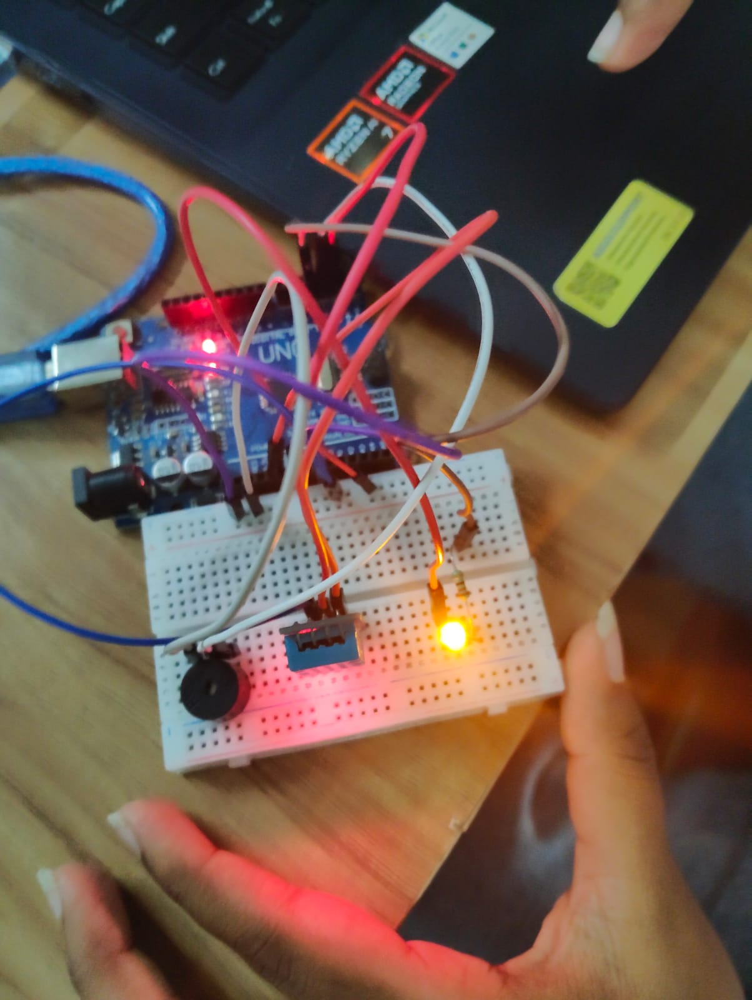

# 🌡️ DHT11 Temperature Sensor with LED and Buzzer 🔔

## 📌 Project Description
This project uses a DHT11 sensor to measure the surrounding temperature. When the temperature exceeds **31°C**, the LED and buzzer turn ON as an alert. Otherwise, both remain OFF.

## 🛠️ Components Required
- Arduino UNO
-  DHT11 Temperature and Humidity Sensor
-  LED
-  Buzzer
-  220Ω Resistor
-  Breadboard
-  Jumper Wires

## 🔗 Connections

| Component | Arduino UNO |
|---|---|
| DHT11 VCC | 5V |
| DHT11 DATA | D2 |
| DHT11 GND | GND |
| LED (+) | D3 (through 220Ω resistor) |
| LED (-) | GND |
| Buzzer (+) | D4 |
| Buzzer (-) | GND |

## ⚙️ Working Principle
1.  DHT11 measures the surrounding temperature.
2.  Arduino reads the temperature value.
3.  If the temperature is above 31°C, the LED and buzzer turn ON.
4.  If the temperature is 31°C or below, the LED and buzzer turn OFF.

## 📚 Libraries Used
- DHT Sensor Library by Adafruit
- Adafruit Unified Sensor Library
  
  [View Arduino Code](dht11_led_buzzer.ino)

## 💻 Code Functions
- `readTemperature()` – Reads the temperature.
- `digitalWrite(HIGH)` – Turns ON the LED and buzzer.
- `digitalWrite(LOW)` – Turns OFF the LED and buzzer.
- `delay(1000)` – Waits for 1 second.

## 📟 Expected Output
-  Temperature above 31°C →  LED ON +  Buzzer ON.
-  Temperature 31°C or below →  LED OFF +  Buzzer OFF.

## 🏠 Applications
- Temperature monitoring systems
- Smart home monitoring
- Heat alert systems
- Environmental monitoring

## 🎯 Conclusion
This project demonstrates how to monitor temperature using the DHT11 sensor and generate an alert using an LED and buzzer when the temperature exceeds the specified limit.

---
✨ **Project:** DHT11 Temperature Monitoring and Alert System  
🔧 **Platform:** Arduino UNO  
💻 **Programming Language:** Arduino C++
